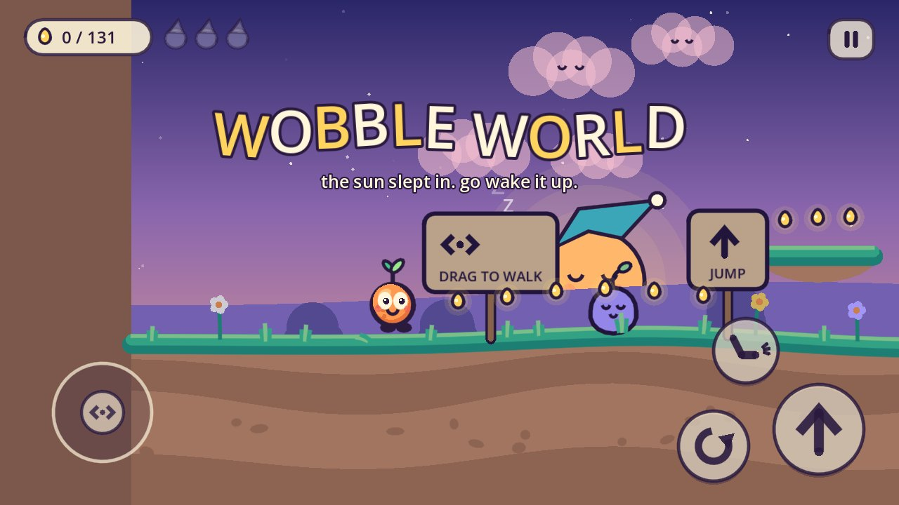
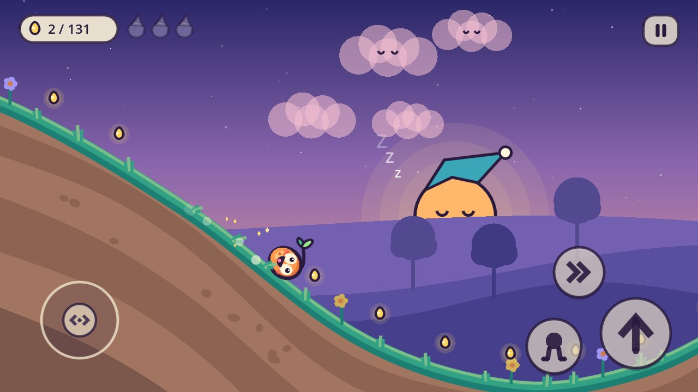
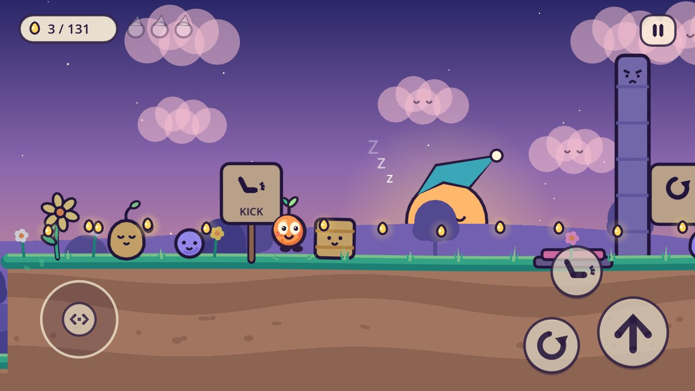
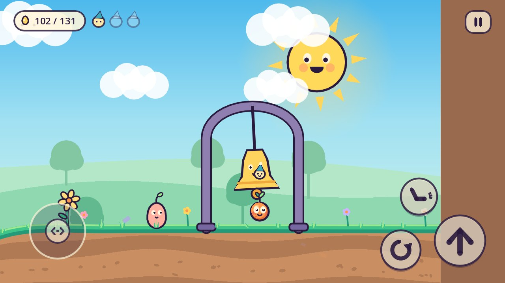

# Wobble World

**The sun slept in. Go wake it up.**

A small, complete mobile platformer starring **Bloop**, a jelly blob with two ways of getting around: springy legs for precise platforming and kicking things, or tucked into a ball that rolls with real momentum. Built with Godot **4.6.1** and GDScript. Every drawing is procedural vector art and every sound (including the music) is synthesized at startup; there are no asset files.



| Rolling hill | Kick yard | Sunrise |
| --- | --- | --- |
|  |  |  |

## The level

One hand-built level, about three to five minutes: meadow, boing ledge, a rolling hill with a leap over the pond, a mushroom garden, a grumpy gate that wants a crate on its button, a hollow floor, a wall that needs a big boing, a long fast descent with a launch ramp, and the bell. Ring it and the world turns from dawn to day.

- **131 sunseeds** to collect, with a rising chime for quick pickups.
- **3 snoozles** asleep in awkward places. Wake one and it follows you.
- **Checkpoint flowers** bloom as you pass. Falling in the pond puts you back at the last one; nothing else can hurt you.
- Sleepy locals with opinions. You can kick them. They will comment.

## Controls

| | Legs | Ball |
| --- | --- | --- |
| **Left thumb** (drag anywhere lower-left) | walk | roll: speeds up downhill, keeps momentum |
| **Jump** (hold for height) | variable-height jump | hop off the ground at the slope's angle |
| **Roll / legs** | tuck into a ball | pop the legs back out and brake |
| **Action** | kick crates, balls, bells, locals | on the ground: boost. In the air: slam |

Hold **Jump** as you land on a mushroom for a bigger boing; slam onto one for the biggest. Slamming also breaks cracked floors.

Desktop: A/D or arrows, Space jump, R or Shift roll, E or X action, Escape pause. The mouse emulates one finger.

The pause menu has back-to-checkpoint, restart, music and sound toggles, and a small lab (collision overlay, walk speed, jump power).

## Play on your phone

Open [Android APK runs](https://github.com/CigThePig/Wobble-World/actions/workflows/android.yml), choose a successful run for the commit you want, and download **WobbleWorld-android-arm64-debug-COMMIT** under Artifacts. Extract the ZIP, tap the APK and install **Wobble World Dev**. Details: [Android guide](docs/ANDROID.md).

## Develop

```sh
# Install official Godot 4.6.1; set GODOT if it isn't on PATH.
python3 tools/verify.py                         # real-engine scenarios + a bot that finishes the level
xvfb-run -a python3 tools/gameplay-verify.py    # Movie Maker video, stills, contact sheets, traces
xvfb-run -a -s '-screen 0 2560x1440x24' python3 tools/layout-verify.py
```

[Architecture and verification](docs/DEVELOPMENT.md) · [Phone checklist](docs/ANDROID.md) · [Status](docs/STATUS.md) · [Agent instructions](AGENTS.md)
