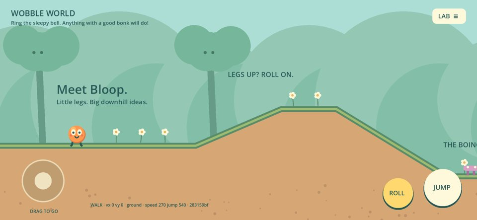

# Wobble World

A cheerful mobile physics playground starring **Bloop**: an orange creature with little legs and big downhill ideas. Built with Godot **4.6.1**, GDScript, original vector drawings and synthesized sounds. No editor is needed to play the Android build.

[First playable PR #1](https://github.com/CigThePig/Wobble-World/pull/1) · [Verified build and evidence](docs/STATUS.md)



## Play on your phone

Open [Android APK runs](https://github.com/CigThePig/Wobble-World/actions/workflows/android.yml), choose a successful run matching the PR's source, and download **WobbleWorld-android-arm64-debug-COMMIT** under Artifacts. Extract its ZIP in Samsung My Files, tap the APK and install **Wobble World Dev**. Full installation/signing notes: [Android guide](docs/ANDROID.md).

- **Left thumb:** touch/drag anywhere in the lower-left movement region. Drag farther for faster movement; lift to release input.
- **Right thumb:** hold **JUMP** for height; tap **ROLL** to tuck/extend Bloop's legs. Both work while moving.
- **LAB:** pause, reset Bloop, reset the physics experiments, restart, show collision/velocity, or change walking/jump power. Backgrounding pauses and clears held inputs.
- **Desktop:** A/D or arrows, Space to jump, R to switch modes, Escape to pause. Mouse emulates one finger.

Climb the hill on legs, roll downhill, hit the mushroom spring, push the face-box, tip the seesaw, and wake the sleepy bell. The gap has a recovery floor; use LAB if you want a fresh start. The bell accepts a moving character or rigid body, rather than a scripted quest sequence.

## Develop through GitHub

Changes live in an open PR. Code updates automatically run real-engine checks/rendered replays and build a signed ARM64 APK plus an x86_64 emulator smoke. Evidence includes MP4, labelled contact sheet, PNGs, JSONL physics/input traces and source-labelled results. Documentation-only changes don't spend build minutes.

```sh
# Install official Godot 4.6.1; set GODOT if it isn't on PATH.
python3 tools/verify.py
xvfb-run -a python3 tools/gameplay-verify.py
xvfb-run -a -s '-screen 0 2560x1440x24' python3 tools/layout-verify.py
```

[Architecture and verification](docs/DEVELOPMENT.md) · [Phone checklist](docs/ANDROID.md) · [Implementation status](docs/STATUS.md) · [Agent instructions](AGENTS.md)
